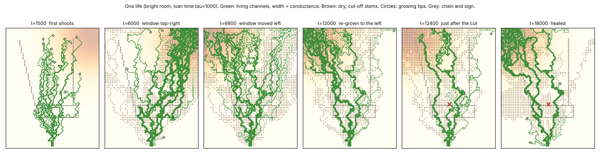
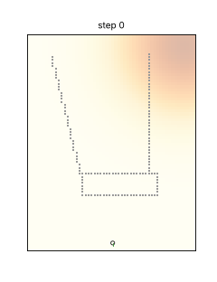
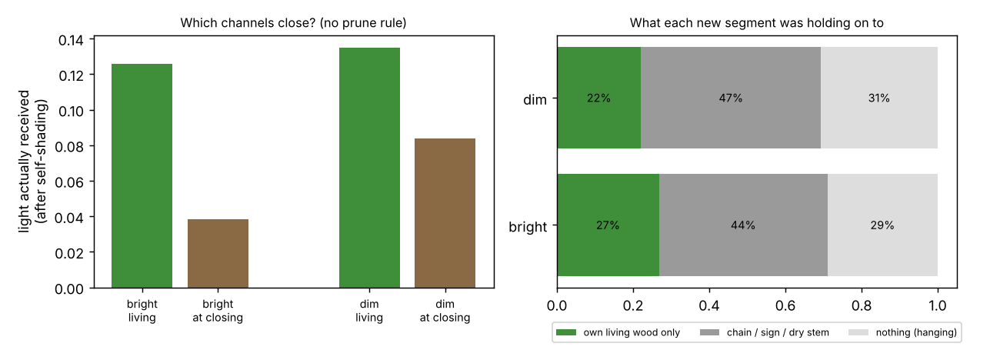
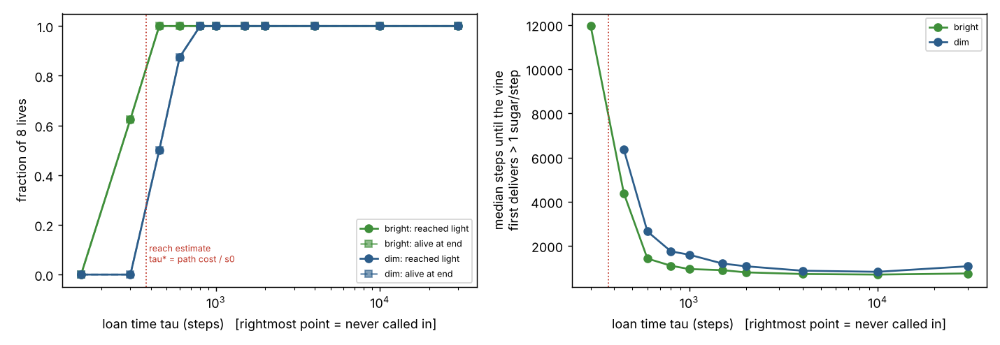
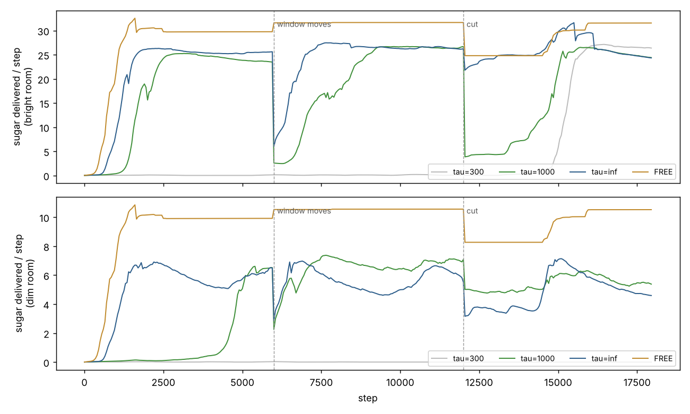

# Elävä Matriisi (Claude) — Gate 0: the vine economy

*A living matrix is a matrix whose entries are kept alive only by what flows through them, paid from a budget they share.*

This started with a real vine. One morning it had let one direction dry up along a chain while wrapping new growth around its own older stems. No one decided that. Gate 0 asks whether a few local, physical rules give the same behaviour **with no prune rule and no task**.



## The model (`vine_economy.py`)

A vine grows on a 56×72 lattice room from a pot on the floor. The room has a chain, a sign plate and a second chain as supports, and a window whose light falls off with distance. Each segment of the vine is an edge with a conductance `D`, the phloem channel. There are four ingredients and nothing else:

1. **Light → sugar.** A segment makes `p = gp·L` and can deliver only what its channel carries: `deliver = p·D/(D+D_h)`. Leaves shade what lies behind them on the line to the window.
2. **One shared body.** Delivered sugar flows down the tree into the pot reserve `R`. Growing tips draw sugar up from `R`. Upkeep `m·D` per segment, doubled for a segment hanging with nothing to hold, is also paid from `R`.
3. **Canalization.** A channel is kept open only by the gross flux `Q` through it:
   `dD/dt = η_i·( D_max·Q/(Q+Q_h) − D )`, with `η_i = η/(1+D/D_wood)²`.
   Thick wood changes slowly and green shoots change fast. A channel whose `D` falls below `D_dead` stops conducting, and everything above it dries where it hangs. Dry stems stay in the room, can be climbed, and crumble after a while.
4. **The loan.** A tip may draw `s0·exp(−a/τ)`, where `a` counts steps since the shoot last paid for itself. `τ` is the one knob: how long the body keeps lending to a direction that hasn't paid off yet. When the loan fades, the flux fades, the channel closes, and the shoot dries. Nothing marks it as failed.

Growth picks a free neighbouring cell with a bias upward, toward supports, and toward brighter light, plus noise. Old woody segments occasionally bud new tips with fresh loans, and so does the pot.

**Each life:** 18,000 steps. The window is top-right until step 6,000, then moves top-left. At step 12,000 the busiest living segment in the middle band is cut.

**The sweep (`experiments/sweep.py`):** 11 loan times (150 … 10,000, ∞) × 2 rooms (bright `gp=0.30`, dim `gp=0.10`) × 8 seeds, plus a **FREE** reference where nothing costs anything and no channel ever closes.



## Results

### 1. Pruning happens without a prune rule

Across every life that reached light, segments whose channel closed had been getting far less light than the segments that stayed alive: **3.3× less in the bright room, 1.6× less in the dim room**. Nothing marks a branch as failed. Shaded and unproductive parts lose their flux, their channels relax, and they dry where they hang. The brown dots in the pictures are that history.



**New growth uses the old body.** About a quarter of all new segments (27% bright, 22% dim) had nothing to hold on to except the plant's own living wood. Dry stems also count as climbable, as on the real vine.

### 2. The loan time τ is a threshold, not a sweet spot (in this economy)



- **Below the threshold, shoots run out of loan before they reach the light.** In the bright room, τ=150 always failed. τ=300, just under the estimate, made it in 5 of 8 lives, but only after many resprouts from the pot (median ~12,000 steps). The simple reach estimate, *path cost ÷ loan rate ≈ 370 steps*, lands in the right place.
- **The dim room needs more patience.** Its threshold sits around 450–800, because a shoot has to get closer to the window before the light pays for it. A poorer world needs a longer loan.
- **Above the threshold, longer loans did not hurt anything I measured.** That includes a loan that is never called in. Income, survival and recovery are flat within the noise from τ≈600 to τ=∞. Time to first light keeps falling up to τ≈4000–10,000.
- **Why curiosity is cheap here:** at most a handful of tips exist at once (median ~3). Each draws 0.1 sugar/step against a canopy income of 5–25/step. The body never hit famine in any life that reached light.

So in Gate 0 the honest statement is: **curiosity must exceed a threshold set by how far away the pay-off is, and beyond that it costs almost nothing.** An optimum would need a world where exploring is expensive relative to income. Examples: many simultaneous tips, a poor room with a small reserve, or exploration that blocks or shades the paying canopy. That is a different experiment.


### bright room

| tau | reached light | alive at end | median steps to first light | income before move | income at end | median steps to recover after window move (n) | median steps to recover after cut (n) |
|---|---|---|---|---|---|---|---|
| 150 | 0/8 | 0/8 | – | – | – | – (0) | – (0) |
| 300 | 5/8 | 5/8 | 11950 | 4.4 | 26.2 | 1450 (1) | 2425 (2) |
| 450 | 8/8 | 8/8 | 4375 | 15.1 | 25.5 | 1050 (7) | 950 (8) |
| 600 | 8/8 | 8/8 | 1425 | 24.5 | 25.8 | 1125 (8) | 2225 (8) |
| 800 | 8/8 | 8/8 | 1100 | 24.1 | 26.0 | 1100 (8) | 1750 (8) |
| 1000 | 8/8 | 8/8 | 950 | 24.1 | 25.2 | 1150 (8) | 1600 (8) |
| 1500 | 8/8 | 8/8 | 900 | 24.7 | 25.8 | 1125 (8) | 2750 (8) |
| 2000 | 8/8 | 8/8 | 800 | 24.6 | 25.6 | 850 (8) | 2725 (8) |
| 4000 | 8/8 | 8/8 | 725 | 24.6 | 25.8 | 1400 (8) | 1975 (8) |
| 10000 | 8/8 | 8/8 | 700 | 25.0 | 25.9 | 1075 (8) | 1125 (8) |
| ∞ | 8/8 | 8/8 | 750 | 24.7 | 25.2 | 1025 (8) | 1625 (8) |

- light received by living segments 0.126, by segments as their channel closed 0.038 (ratio 3.3x)
- new segments holding on to: own living wood only 27%, chain/sign/dry stem 44%, nothing 29%
- light alignment of the living body (mean light on segments / room mean): economy 2.43 before move, 2.39 after; FREE 1.06
- income before cut: economy 25.1/step with upkeep 2.1; FREE 31.6/step, and its upkeep if billed at the same rate would be 11.9 (net +19.7 vs +22.9)
- famine (body reserve hit zero): 0.00% of logged steps

### dim room

| tau | reached light | alive at end | median steps to first light | income before move | income at end | median steps to recover after window move (n) | median steps to recover after cut (n) |
|---|---|---|---|---|---|---|---|
| 150 | 0/8 | 0/8 | – | – | – | – (0) | – (0) |
| 300 | 0/8 | 0/8 | – | – | – | – (0) | – (0) |
| 450 | 4/8 | 4/8 | 6350 | 1.8 | 6.1 | 525 (2) | 2575 (4) |
| 600 | 7/8 | 7/8 | 2650 | 5.8 | 6.1 | 1050 (7) | 2800 (7) |
| 800 | 8/8 | 8/8 | 1750 | 4.6 | 5.7 | 1550 (7) | 875 (8) |
| 1000 | 8/8 | 8/8 | 1600 | 4.7 | 5.6 | 700 (7) | 2400 (8) |
| 1500 | 8/8 | 8/8 | 1200 | 5.5 | 5.3 | 950 (8) | 1025 (8) |
| 2000 | 8/8 | 8/8 | 1075 | 5.4 | 6.0 | 375 (8) | 1275 (8) |
| 4000 | 8/8 | 8/8 | 875 | 5.7 | 5.9 | 1025 (8) | 1425 (8) |
| 10000 | 8/8 | 8/8 | 825 | 4.9 | 5.7 | 750 (7) | 1325 (8) |
| ∞ | 8/8 | 8/8 | 1075 | 5.6 | 5.6 | 350 (8) | 2725 (8) |

- light received by living segments 0.135, by segments as their channel closed 0.084 (ratio 1.6x)
- new segments holding on to: own living wood only 22%, chain/sign/dry stem 47%, nothing 31%
- light alignment of the living body (mean light on segments / room mean): economy 2.08 before move, 2.05 after; FREE 1.06
- income before cut: economy 5.6/step with upkeep 1.4; FREE 10.5/step, and its upkeep if billed at the same rate would be 11.9 (net -1.4 vs +4.3)
- famine (body reserve hit zero): 0.00% of logged steps


The **FREE** reference (no costs, nothing ever closes) fills the whole room. It earns more gross light, but its body says nothing about where the light is: light alignment is about 1.0 versus about 2.1–2.4 for the economic vine. Billed at the same upkeep rate, it would net less in the bright room and **lose money in the dim room** (−1.4/step versus +4.3/step).



### 3. Wood ablation (Sol's test): slow thick channels vs uniformly fast channels

Same seeds, same moving window, same cut. "Slow wood" means `η_i = η/(1+D/D_wood)²`. "All fast" means every channel relaxes at the green-shoot rate.

| room | tau | channels | reached light | alive at end | died after window move | transport kept at worst (after move) | living structure kept 500 steps after move | median steps to recover (move) | transport kept at worst (after cut) | median steps to recover (cut) |
|---|---|---|---|---|---|---|---|---|---|---|
| bright | 1000 | slow wood | 8/8 | 8/8 | 0/8 | 0.33 | 1.11 | 1150 | 0.63 | 1600 |
| bright | 1000 | all fast | 8/8 | 8/8 | 0/8 | 0.33 | 1.00 | 525 | 0.48 | 2850 |
| bright | ∞ | slow wood | 8/8 | 8/8 | 0/8 | 0.40 | 0.97 | 1025 | 0.65 | 1625 |
| bright | ∞ | all fast | 8/8 | 8/8 | 0/8 | 0.41 | 0.74 | 850 | 0.44 | 2400 |
| dim | 1000 | slow wood | 8/8 | 8/8 | 0/8 | 0.38 | 1.01 | 700 | 0.35 | 2400 |
| dim | 1000 | all fast | 8/8 | 8/8 | 0/8 | 0.38 | 0.78 | 675 | 0.35 | 2775 |
| dim | ∞ | slow wood | 8/8 | 8/8 | 0/8 | 0.47 | 1.40 | 350 | 0.39 | 2725 |
| dim | ∞ | all fast | 8/8 | 8/8 | 0/8 | 0.68 | 0.90 | 225 | 0.52 | 2425 |


**What this says, honestly:**

- **Wood is retention, not survival.** With the final model, the all-fast vine also survives every window move (0/8 deaths in all conditions).
- **Wood keeps more of the living body through a shock.** Living structure 500 steps after the move was 0.97–1.40 of its pre-move size with wood, versus 0.74–1.00 all fast.
- **Wood keeps more transport through the bright-room cut.** Worst-case income kept was 0.63–0.65 with wood, versus 0.44–0.48 all fast, and recovery was faster (1600–1625 vs 2400–2850 steps). In the dim room it did not help: 0.35 vs 0.35 at τ=1000, and 0.39 vs 0.52 in favour of fast channels at τ=∞.
- **Fast channels re-orient faster or equally fast after the window moves.** In the dim never-called-loan case, all fast also kept more income through the move (0.68 vs 0.47). Forgetting the old canopy quickly can help.
- **So wood trades agility for memory.** That is the stability/plasticity trade-off, measured on a vine, and neither setting wins everywhere.

**A correction to what I first claimed in the chat:** an early version of this model died "rich" after the window moved, and I credited slow wood with the fix. That version also almost never resprouted from the pot. With ready resprouting, the ablation shows fast-only vines survive too. Slow wood changes how much is kept, not whether the plant lives.

## Honest ledger

**Shown:**
- Pruning that targets low-light parts with no prune rule (3.3× / 1.6× light gap).
- Growth on the plant's own wood.
- Re-orientation after the window moves and healing after a cut, with no instruction.
- A loan threshold that sits where a one-line reach estimate puts it, and that rises in a poorer room.
- Wood as a retention-vs-agility trade-off rather than a pure win.

**Not shown:**
- An optimum curiosity. Long loans were free here.
- Anything about computation, a matrix doing a task, or language. Gate 0 is only the economy.
- Robustness to the many fixed constants (`gp, Dh, Dmax, Qh, η, m, s0, kR, cgrow, …`). These were set once, by hand, to put the vine in a regime where it can live; they were not fitted to the results.

**Statistics:** 8 seeds per cell, medians. Recovery times are noisy and I would not read trends from single rows.

## Next (candidates, not commitments)

- **Let the body set its own curiosity.** Two options: `τ = τ₀·R/(R+R_h)`, where rich bodies lend longer, or τ inherited by buds with mutation. Then check whether different rooms converge on τ above their own thresholds. First build a room where curiosity costs something, so there is anything to find.
- **Sol's two-organism test.** Two vines grow separately and exchange signals through a narrow channel. Does repeated exchange leave stable, reusable structure, and can a third, independently grown vine acquire it without copying the matrix? This is the link to language. Words are channels kept open by use, and the frequent ones turn to wood (Lieberman et al. 2007; Pagel et al. 2007). A language passed through learners' bottlenecks becomes structured (Kirby, Cornish & Smith 2008).
- **The matrix version.** Same economy on a weight matrix, where the "light" is how well a path anticipates its own next input, and nothing is backpropagated.

## Run it

```
pip install numpy numba matplotlib
python experiments/sweep.py          # ~10 min on 2 cores -> results/sweep.json
python experiments/summarize.py      # -> results/summary.md
python experiments/wood_ablation.py  # -> results/wood_ablation.md
python experiments/figures.py        # -> figures/
```

Sister repo with a different mechanism (explicit loan expiry, interactive page): [ElavaMatriisiSol](https://github.com/anttiluode/ElavaMatriisiSol).

